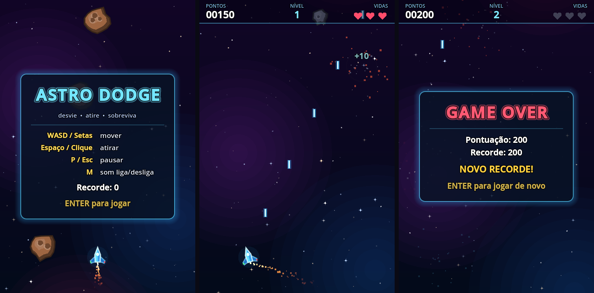

# Astro Dodge 

Joguinho de nave feito na Godot 4.3 pro trabalho de Desenvolvimento de Jogos Digitais.

A ideia é simples: vai caindo asteroide do espaço e vc tem que desviar ou explodir eles. Bateu 3 vezes, já era.

## Controles

- **WASD** ou **setinhas** - mexe a nave
- **Espaço** ou **clique** - atira
- **P** ou **Esc** - pausa
- **M** - liga/desliga o som
- **Enter** - começa (ou recomeça qnd perde)

## Regras

- asteroide cinza = 10 pontos, morre com 1 tiro
- asteroide marrom (o grandao) = 25 pontos, precisa de 2 tiros. no primeiro ele racha
- 3 vidas. depois de apanhar a nave fica imortal uns segundos (pisca e aparece um escudo)
- a cada 15 segundos sobe o nivel e começa a cair mais asteroide, e mais rapido
- o recorde fica salvo msm fechando o jogo

## Como rodar

1. baixa a Godot 4.3 (ou mais nova) em https://godotengine.org/download
2. abre a Godot, clica em **Importar** e escolhe o arquivo `project.godot`
3. aperta **F5**

No Ubuntu, se der erro de video, abre a Godot assim: `./Godot_v4.3-stable_linux.x86_64 --rendering-driver opengl3`

## O q tem no jogo (conceitos da materia)

- **entrada do jogador**: teclado e mouse (`player.gd`, as teclas tao configuradas no `project.godot`)
- **movimento com transform**: nave, tiro e asteroide andam mexendo direto na `position`
- **colisao**: com Area2D, tiro x asteroide e asteroide x nave (`asteroid.gd`)
- **pontos, vidas, game over e recorde** (`main.gd`)
- **estados do jogo**: menu, jogando, pausado e game over (`main.gd`, funçao `change_state`)
- **comportamentos**: imortal depois de apanhar, asteroide rebatendo na parede, dificuldade subindo com o tempo
- **feedback pro jogador**: placar, coraçoes, explosao, tela tremendo, tela vermelha qnd apanha, "+10" subindo, aviso de nivel e os sons

## Arquivos

- `main.gd` - o principal, controla tudo
- `player.gd` - a nave
- `asteroid.gd` - os asteroides
- `bullet.gd` - o tiro
- `background.gd` - fundo com as estrelas e as nebulosas
- `shockwave.gd` - o anel q aparece nas explosoes
- `sfx.gd` - os sons

Nao tem nenhuma imagem nem arquivo de audio no projeto, é tudo desenhado e gerado por codigo.
